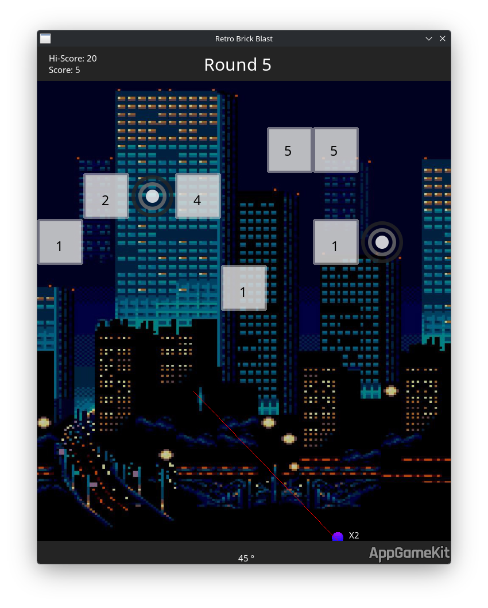

# Versão em Python

Recriação jogável de **Retro Brick Blast / Brick Blocks** em Python com Pygame,
reutilizando as imagens e as cinco músicas desta pasta. Inclui disparo sequencial,
reflexão nas paredes e blocos, coleta de bolas extras, rodadas progressivas,
fim de jogo e recorde persistente.

## Executar

Requer Python 3.10 ou superior. No terminal, dentro desta pasta:

```sh
python -m venv .venv
```

Ative o ambiente:

- Windows: `.venv\Scripts\activate`
- Linux/macOS: `source .venv/bin/activate`

```sh
python -m pip install -r requirements.txt
python main.py
```

Mantenha as imagens e os arquivos `.ogg` junto dos arquivos Python.
Os recursos são encontrados pelo caminho de `main.py`, mesmo ao iniciar de outra pasta.
Se não houver dispositivo de áudio, o jogo continua sem música.

## Como jogar

Mova o mouse para mirar acima da bola e clique com o botão esquerdo para lançar.
Cada impacto reduz o número do bloco em um; ao chegar a zero, ele desaparece.
Os círculos acrescentam bolas ao próximo disparo. O primeiro ponto de retorno
vira a origem da próxima rodada. Quando todas as bolas retornam, os blocos descem
e uma nova linha aparece. A partida acaba se um bloco alcançar a linha inferior.

| Tecla | Ação |
| --- | --- |
| P | Pausar ou continuar |
| Espaço (segurar) | Acelerar as bolas em 4× |
| B | Recolher a salva e avançar a rodada |
| M | Ligar/desligar música |
| R | Reiniciar a partida |
| Esc | Sair |

A janela pode ser redimensionada. O recorde é a maior rodada alcançada e fica
na pasta de dados do usuário (`APPDATA` no Windows, `XDG_DATA_HOME` ou
`~/.local/share` no Linux), em `brick-blocks-python/record.json`.

## Código e verificações

- `engine.py`: regras, geração de linhas e física sem dependências gráficas.
- `main.py`: interface Pygame, sprites, músicas, controles e persistência.
- `tests/test_engine.py`: testes de colisão, rodadas, coleta e fim de jogo.

```sh
python -m unittest discover -s tests -v
```

Verificação gráfica sem abrir uma janela (Linux/macOS):

```sh
SDL_VIDEODRIVER=dummy SDL_AUDIODRIVER=dummy python main.py --mute --frames 5 --screenshot /tmp/brick-blocks.png
```

Esta é uma reimplementação baseada na captura de tela, nos recursos fornecidos e
nas regras descritas abaixo. A inspeção estática do executável confirmou o título,
os rótulos de pontuação e os nomes dos recursos. O executável Windows não foi
executado neste ambiente Linux; velocidades, distribuição dos blocos e alternância
de fundos/músicas são escolhas da recriação, sem equivalência exata comprovada.

---

# Brick Blast Ball (Réplica)

Este repositório contém o projeto de uma réplica do jogo **Brick Blast Ball**, desenvolvido como atividade prática para a disciplina de **Laboratório de Programação** do 1º período do curso de **Bacharelado em Ciência da Computação** do **Instituto Federal de Goiás (IFG) - Câmpus Anápolis**.

---

## 📌 Contexto Acadêmico

Como sugerido no [Projeto Pedagógico do Curso (PPC) de Ciência da Computação do IFG](https://www.ifg.edu.br/attachments/article/1042/PPC_CienciaComputacao.pdf), a ferramenta **AppGameKit** é adotada logo no primeiro período na disciplina de **Laboratório de Programação**. O objetivo dessa abordagem lúdica é estimular e desenvolver:
- **Lógica de programação** de forma visual e interativa.
- **Competências matemáticas e geométricas** (vetores, colisões, reflexão de ângulos).
- **Resolução de problemas complexos** por meio da estruturação e arquitetura de um jogo completo desde o início da graduação.

---

## 🎮 O Jogo: Brick Blast Ball

O jogo é um clássico de estilo *Brick Breaker* / *BBTAN*, onde o jogador deve mirar e lançar esferas para quebrar blocos numerados. Cada bloco possui um número que representa a quantidade de impactos necessários para destruí-lo. À medida que as rodadas avançam, novos blocos surgem com valores maiores, e o jogador pode coletar itens para aumentar o número de esferas disparadas por rodada.

### Funcionalidades
- **Sistema de Mira e Lançamento:** Lançamento de esferas com física de reflexão nas paredes e blocos.
- **Destruição Progressiva de Blocos:** Blocos numerados que exigem múltiplos impactos para serem quebrados.
- **Trilha Sonora Dinâmica:** Efeitos sonoros e músicas ambientais para imersão no jogo.
- **Dificuldade Incremental:** O jogo se torna progressivamente mais desafiador com o aumento do valor dos blocos a cada rodada.

---

## 🛠️ Tecnologias Utilizadas

- **Engine de Desenvolvimento:** [AppGameKit (AGK)](https://www.appgamekit.com/)
- **Linguagem:** AGK BASIC (Tier 1) - *desenvolvido utilizando a linguagem nativa do AppGameKit para controle de lógica de tela, movimentação e colisões física*.
- **Assets de Áudio:** Efeitos e trilhas dinâmicas em formato `.ogg`.
- **Assets de Imagem:** Sprites 2D personalizados para fundos, blocos e projéteis.

---

## 📂 Estrutura do Projeto

O repositório está estruturado com os seguintes componentes principais:
- [Brick Blocks.exe](file:///zoomer/brick-blast-ball/Brick%20Blocks.exe): O executável compilado do jogo, pronto para rodar.
- Imagens de fundo (`back0.jpg` a `back9.png`): Planos de fundo utilizados nas fases do jogo.
- Sprites do jogo (`ball.png`, `gBall.png`, `square.png`): Texturas para as esferas normais/especiais e os blocos.
- Áudios do jogo (`song1.ogg` a `song5.ogg`): Trilha sonora e efeitos sonoros de impacto e feedback.
- [screenshot.png](file:///zoomer/brick-blast-ball/screenshot.png): Captura de tela demonstrando o jogo em execução.

---

## 📷 Captura de Tela (Screenshot)

Confira abaixo uma captura de tela do jogo em execução:



---

## 🚀 Como Executar

Para rodar o jogo localmente no Windows:
1. Clone este repositório ou baixe os arquivos diretamente.
2. Execute o arquivo [Brick Blocks.exe](file:///zoomer/brick-blast-ball/Brick%20Blocks.exe).
3. Use o mouse para mirar e clique para lançar as esferas.

---
*Desenvolvido como parte das atividades acadêmicas de Bacharelado em Ciência da Computação — IFG Câmpus Anápolis.*
